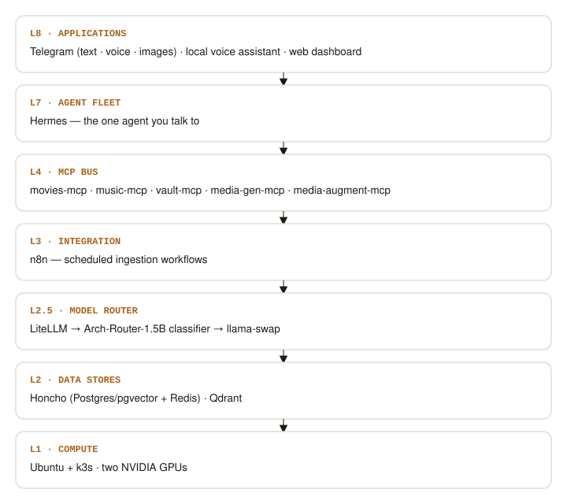
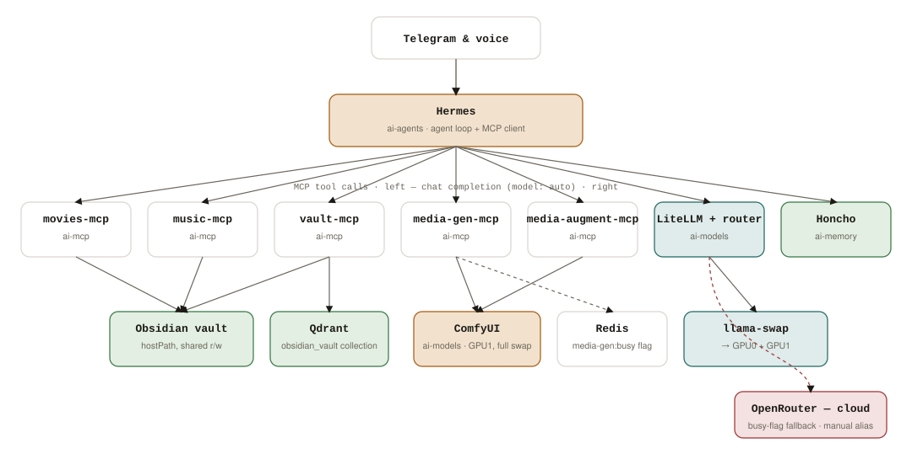
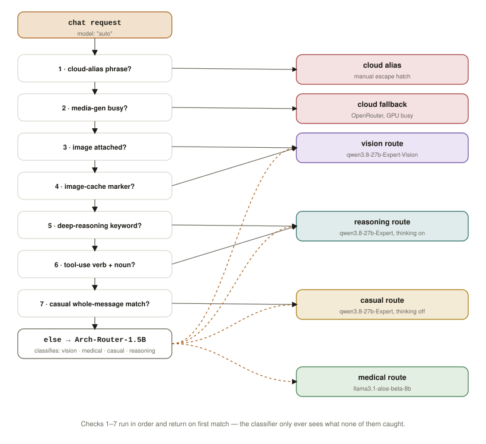
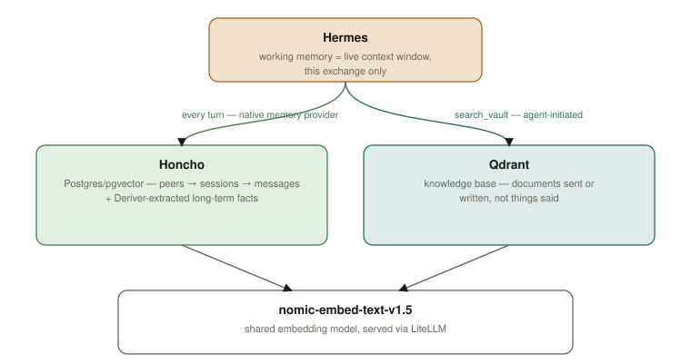
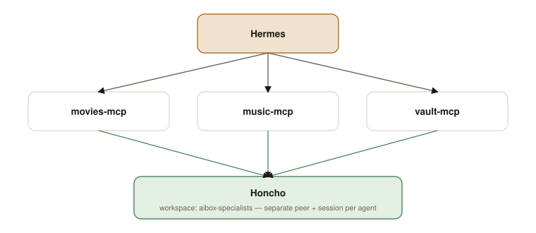
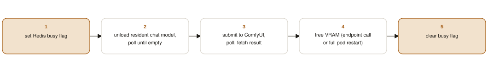
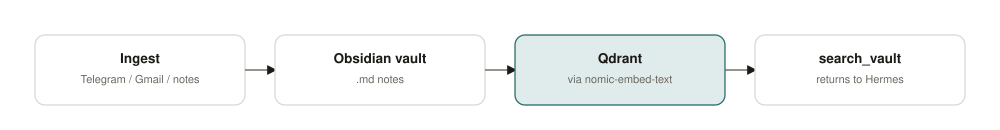
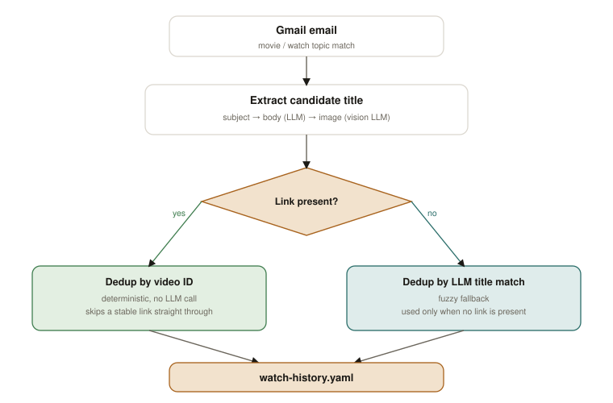

# aibox — Personal AI Platform

A single-node [k3s](https://k3s.io) cluster turning one Ubuntu box into a personal AI assistant — reachable over Telegram, voice, and a local dashboard — backed by a fleet of small domain-specialist agents, local LLM inference, and a self-hosted knowledge base. Everything is deployed from this repo through ArgoCD (GitOps): push a manifest change, the cluster reconciles itself.

**Hardware:** Ubuntu 26.04 Server + XFCE · 64GB RAM · two NVIDIA GPUs (RTX 5070 Ti 16GB + RTX 3060 12GB) · 2TB SSD (100GB `/`, ~1.86TB `/data` — k3s's own data directory lives on `/data`, off the small system partitions).

## Contents

- [Layer stack](#layer-stack)
- [Request path — services and GPUs](#request-path--services-and-gpus)
- [Core infrastructure](#core-infrastructure)
- [Model routing](#model-routing)
- [GPU split](#gpu-split)
- [Memory architecture](#memory-architecture)
- [Specialist agents](#specialist-agents)
- [Media generation](#media-generation)
- [Data ingestion & RAG](#data-ingestion--rag)
- [Observability](#observability)
- [Voice assistant](#voice-assistant)
- [Repository layout](#repository-layout)
- [Namespaces](#namespaces)
- [Bootstrapping](#bootstrapping)

## Layer stack



A request enters at the top — Telegram, voice, or the dashboard — and descends through the agent, its tools, the model router, and finally a data store.

## Request path — services and GPUs

The concrete version of the layer stack above: which pod actually calls which, and which GPU each one lands on. Hermes never talks to a model or a generator directly — everything goes through one of two gateways, MCP for tool calls or LiteLLM for chat — and both eventually contend for the same primary GPU.



Tool calls (left) and chat completions (right) are separate paths from Hermes, but they converge on GPU1 — which is why media generation sets a Redis busy flag that the router checks (cross-checked directly against ComfyUI's own queue as a second signal) before routing a chat request anywhere.

## Core infrastructure

- **Hermes** — the agent front door, reached over Telegram (text, voice, images) and a direct local-voice channel. Runs as the `hermes-agent` pod, with its own web dashboard. Its config (`config.yaml`, registering every MCP tool) and persona (`SOUL.md`) are seeded from a ConfigMap into a PVC on first boot. It mounts the Obsidian vault directly, so anything sent to it over Telegram lands straight in the vault.
- **Honcho** — persistent memory, with four distinct layers: Hermes's own context window (ephemeral), Honcho's session memory (what was actually said), Honcho's longer-term derived facts (Postgres/pgvector + Redis, built by a Deriver process), and Qdrant as a separate document knowledge base (things sent or written, not said). All of Honcho's own model slots run on a dedicated GPU (see GPU split below).
- **LiteLLM / llama-swap** — the model router. Every model call on the platform, chat or embedding, goes through LiteLLM to llama-swap. Routing is a custom pre-call hook (not LiteLLM's stock gateway), which runs a deterministic priority chain before ever calling a classifier (see Model routing below).

## Model routing

Every chat completion uses `model: "auto"`. A chain of deterministic checks in a custom pre-call hook tries to resolve the route first — each check only looks at the latest user turn — and only falls through to a classifier model if none of them match.



| Route | Model |
|---|---|
| vision | qwen3.8-27b-Expert-Vision |
| medical | llama3.1-aloe-beta-8b |
| casual | qwen3.8-27b-Expert, thinking off |
| reasoning (default) | qwen3.8-27b-Expert, thinking on |
| cloud alias | manual, phrase-triggered — a deliberate escape hatch to a cloud model when a question is clearly bigger than what's resident locally |
| cloud fallback | OpenRouter — used only while GPU1 is held by a media generation job |

General auto-fallback to a cloud model on a local-model *failure* is a separate, independent setting (currently off, so a local failure surfaces rather than being silently masked) — distinct from the media-gen busy fallback above, which always stays active.

## GPU split

| GPU | Role | Resident models |
|---|---|---|
| RTX 5070 Ti · 16GB | Primary — reasoning/vision models + ComfyUI image & video generation | qwen3.8-27b-Expert, qwen3.8-27b-Expert-Vision, hermes3-llama-3.1-8b, llama3.1-aloe-beta-8b, ComfyUI |
| RTX 3060 · 12GB | Dedicated to Honcho's memory pipeline | qwen3-1.7b-gpu |
| CPU only | Lightweight, always resident | arch-router-1.5b (classifier), nomic-embed-text-v1.5 (embeddings) |

GPUs are pinned by UUID rather than index, since CUDA's own device numbering and `nvidia-smi`'s don't always agree.

## Memory architecture

Session memory isn't a separate layer bolted on — it's the middle tier of Honcho's own schema (`peers → sessions → messages`). Qdrant is a wholly separate, deliberate-lookup knowledge base: documents that were written or sent, not things that were said.



## Specialist agents

Hermes delegates to a growing set of small domain specialists rather than doing everything itself — each is its own MCP server pod in `ai-mcp`, isolated so a bug in one can't take the others down. They all persist conversation memory through the same Honcho deployment, sharing one workspace but kept apart by their own peer/session id; what each agent actually stores (a watch history, a song library) lives as its own small file under the Obsidian vault, which is already backed up as one unit.



**movies-mcp**

| Tool | Purpose |
|---|---|
| `ask_movies` | Answers from `watch-history.yaml`'s lists — completed, on hold, suggested, wishlist, anticipated, interests |
| `check_anticipated` | Flags releases being watched for, checked against real release/season status (TMDB) |

`watch-history.yaml` also has a second writer outside Hermes entirely: a Gmail ingestion branch (part of the n8n pipeline, see Data ingestion below) that recognizes movie-share emails and appends new titles to the wishlist directly — movies-mcp only ever reads and answers from the file.

**music-mcp**

| Tool | Purpose |
|---|---|
| `ask_music` | Checks whether a song is in the local MP3 collection — a fast exact-match lookup first, falling back to a reasoning model for fuzzy/spelling variants |
| `list_songs_by_artist` | Lists everything by a given artist in the collection |

**vault-mcp** — the odd one out, closer to ingestion infrastructure than a domain specialist:

| Tool | Purpose |
|---|---|
| `search_vault` | Embeds the query, searches Qdrant's `obsidian_vault` collection, returns the matching chunks |
| `ingest_note` | Writes dictated/pasted text as a new note (whitelisted folders only), then chunks, embeds, and upserts it into Qdrant |
| `ingest_file` | Saves an image/PDF/docx into the vault — extracts text directly, or OCRs via the local vision model (falling back to a local OCR engine if that's unreachable) — links it from a new note and indexes it |

## Media generation

Two separate services generate and edit images/video, deliberately split so a bug in one can't destabilize the other. Both follow the same rule: **full GPU swap, every time** — GPU1 only ever holds one generator or the chat model, never both.



**media-gen-mcp**

| Tool | Model | Notes |
|---|---|---|
| `generate_image` | Z-Image Turbo (bf16, text encoder Qwen3-4B, 8-step distilled) | VRAM freed via ComfyUI's own release endpoint |
| `generate_video` | A two-pass graph — low-res draft → 2× latent upscale → distilled refine — with synced audio output | Character/reference expansion via a local LLM runs *before* the GPU handoff, not after; cleanup is a full pod restart rather than trusting the release endpoint alone |
| `generate_music` | 8-step turbo generation with vocals (text encoder: smaller Qwen variants) | Cleanup is a full pod restart |

**media-augment-mcp**

| Tool | Model | Notes |
|---|---|---|
| `edit_image` | Qwen-Image-2.1 edit | Needs an existing input image, not just a prompt — background swaps, compositing, reference edits |

Results come back to Hermes through a shared hostPath volume plus an explicit `MEDIA:<path>` tag in the tool's own return text, since Hermes doesn't auto-attach binary output otherwise — it only scans its reply text for a file reference.

While any of these tools holds the GPU, any chat `auto` call gets redirected to the cloud fallback rather than queued, and the chat model reloads lazily once the generation finishes freeing VRAM.

## Data ingestion & RAG

Telegram attachments and n8n-synced Gmail land in the vault automatically; a note or file can also be handed to Hermes directly, which reaches the vault the same way.



`vault_sync.py` (a standalone bulk/scheduled script) and vault-mcp's own `ingest_note`/`ingest_file` tools both chunk by heading and embed via the one platform-wide embedding model, then upsert into Qdrant — deleting each note's old points first so nothing stale survives a re-run. `search_vault` is the one tool Hermes actually calls to answer a question: it embeds the query, searches Qdrant, and returns the matching chunks straight from Qdrant's stored payload, without re-reading the raw file.

n8n drives the scheduled Telegram/Gmail side of ingestion. One branch of that pipeline bypasses the vault entirely — a movie/watch-wishlist detector that reads and writes `watch-history.yaml` directly, the same file movies-mcp answers from:



The title-extraction cascade tries the subject line first (free, at most one title), then the email body via an LLM (zero or more candidate titles), then any attached images via a vision model — the first non-empty level wins. Each candidate is deduplicated by comparing a stable video ID when a link is present (deterministic, skips the LLM call entirely), falling back to a fuzzy LLM title match only when there's no link to compare.

## Observability

Every model call, every pod's logs, and every GPU's load are visible in one place:

- **Metrics** — node-exporter + dcgm-exporter (GPU) + kube-state-metrics feed Prometheus, visualized in Grafana — node CPU/RAM, GPU utilization/VRAM/temperature, pod restarts.
- **Logs** — Promtail (one per node) ships everything to Loki, browsed from Grafana's Explore tab.
- **LLM traces** — a self-hosted LangFuse, with its own ClickHouse for OLAP storage and MinIO for blobs. LiteLLM is the single wiring point — it sends every completion to LangFuse as a trace and exposes its own metrics for Prometheus to scrape.

## Voice assistant

A local, Telegram-free channel: a wake word triggers speech-to-text, which calls Hermes's own local API (chaining replies for a short window of context), and a TTS engine speaks the reply back — auto-detecting English or Russian per turn and picking the matching voice. It runs as a host-level script rather than a pod, for direct access to the mic/speaker hardware, and is distinct from Telegram's own voice-message support.

## Repository layout

```
k8s/
├── bootstrap/     ArgoCD Application resources (the "app of apps")
├── p0/            Cluster skeleton — namespaces
├── p1/            Model layer — llama-swap, LiteLLM, model-router dashboard
├── p2/            Data layer — Honcho, Postgres/pgvector, Redis, Qdrant
├── p3/            Agent layer — Hermes + the MCP specialist/media servers
├── p8/            Observability — Prometheus, Grafana, Loki, LangFuse
├── media-gen/     Standalone ComfyUI deployment
├── n8n/           Ingestion workflow engine
└── secrets/       Secrets consumed across phases

apps/
├── hermes-agent-honcho/   Hermes's own container build + config
├── movies-mcp/            Watch-history / wishlist specialist
├── music-mcp/             Song-library specialist
├── vault-mcp/             Vault search + ingest specialist
├── media-gen-mcp/         generate_image / generate_video / generate_music
├── media-augment-mcp/     edit_image
└── n8n/                   Custom n8n image with the sync scripts baked in

scripts/           Host-level scripts that don't belong in a pod:
                   vault_sync.py, gmail_sync.py, telegram_sync.py,
                   the voice-assistant pipeline
```

## Namespaces

| Namespace | Houses |
|---|---|
| `ai-models` | LiteLLM, llama-swap, the model-router dashboard, ComfyUI |
| `ai-memory` | Honcho, Postgres/pgvector, Redis, Qdrant |
| `ai-mcp` | Every specialist and media MCP server |
| `ai-agents` | Hermes |
| `ai-integration` | n8n (ingestion workflows) |
| `ai-observe` | Prometheus, Grafana, Loki, Promtail, LangFuse |

## Bootstrapping

1. Install k3s (with `--data-dir /data/k3s`, off the system partitions) and ArgoCD on the box.
2. Push this repo to a private GitHub remote ArgoCD can reach.
3. Set `repoURL` in `k8s/bootstrap/root-app.yaml` to that remote.
4. `kubectl apply -f k8s/bootstrap/root-app.yaml` — the one manifest applied by hand; every phase after that is an ArgoCD Application that reconciles automatically on push.
5. The `apps/*` services are built and loaded directly on the box rather than pulled from a registry (`docker build` + `k3s ctr images import`, then a rollout restart) — this is a single-node personal cluster, so there's no CI/registry step.
